Deploy a front end and backend using both secrets and configmap

Below is the target architecture

```
                    ┌──────────────────┐
                    │     FRONTEND     │
                    │   React / Vite   │
                    └────────┬─────────┘
                             │
                             │ HTTP API
                             ▼
                    ┌──────────────────┐
                    │      BACKEND     │
                    │  Node.js/Express  │
                    │                  │
                    │  ConfigMap       │
                    │  Secret          │
                    └────────┬─────────┘
                             │
                             │ DB connection
                             ▼
                    ┌──────────────────┐
                    │     DATABASE     │
                    │      MySQL      │
                    └──────────────────┘

```

Now the Project Architecture

```
frontend-backend-k8s/
│
├── namespace.yaml
│
├── backend/
│   ├── app.js
│   ├── package.json
│   ├── Dockerfile
│   │
│   ├── configmap.yaml
│   ├── secret.yaml
│   │
│   ├── database/
│   │   ├── deployment.yaml
│   │   └── service.yaml
│   │
│   ├── deployment.yaml
│   └── service.yaml
│
└── frontend/
    ├── src/
    │   ├── App.jsx
    │   └── main.jsx
    ├── package.json
    ├── Dockerfile
    ├── nginx.conf
    ├── deployment.yaml
    └── service.yaml
```

1. kind-config.yaml
This is a configuration file used to deploy nodes in a ""kind cluster""

In this regards I have to deploy it along with the cluster namespace

below is the command:

```
kind create cluster --name frontend-backend --config kind-config.yaml
```

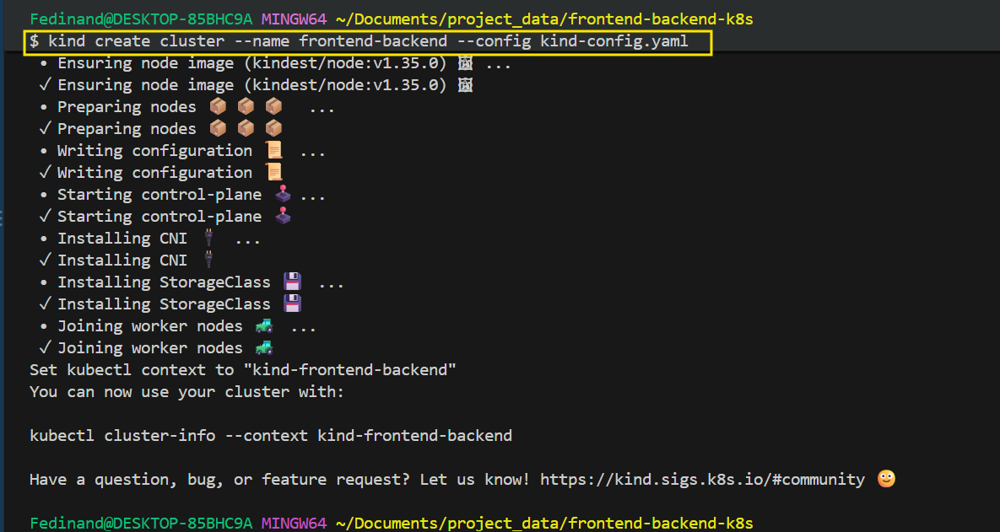

The Image shows the created nodes running in the kind cluster in the docker-desktop.

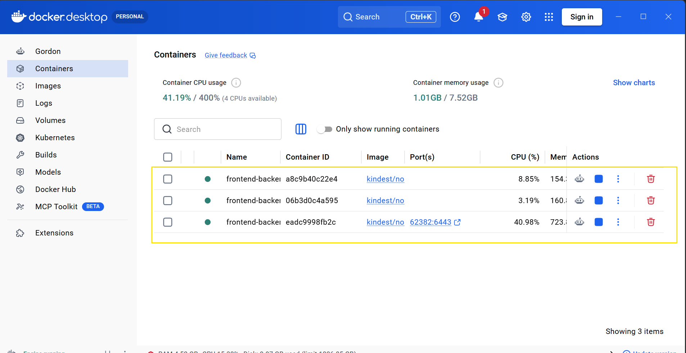

Below is the namespace I used in creating the kind-cluster and the nodes.

2. Namespace

```
namespace.yaml
```

The namespace.yaml manifest

```
apiVersion: v1
kind: Namespace
metadata:
  name: frontend-backend
```

At this point I have to create a Sub-directories from the root directory like the "Backend"

Inside the Backend directory you will see the configmap, secret, database-subdirect etc.


3. Configmap
This contains **non-sensitive** database configuration


```
configmap.yaml
```
```
apiVersion: v1
kind: ConfigMap
metadata:
  name: backend-config
  namespace: frontend-backend
data:
  DB_HOST: "database-service"
  DB_PORT: "3306"
  DB_NAME: "appdb"
```

4. Secret

```
secret.yaml
```

```
apiVersion: v1
kind: Secret
metadata:
  name: backend-secret
  namespace: frontend-backend
type: Opaque
stringData:
  DB_USER: "appuser"
  DB_PASSWORD: "apppassword"
```
******************************************
5. DataBase

I will use MySQL

database/deployment.yaml

```
apiVersion: apps/v1
kind: Deployment
metadata:
  name: database-deployment
  namespace: frontend-backend
spec:
  replicas: 1
  selector:
    matchLabels:
      app: database
  template:
    metadata:
      labels:
        app: database
    spec:
      containers:
        - name: mysql
          image: mysql:8.0
          ports:
            - containerPort: 3306
          env:
            - name: MYSQL_DATABASE
              value: "appdb"

            - name: MYSQL_USER
              value: "appuser"

            - name: MYSQL_PASSWORD
              value: "apppassword"

            - name: MYSQL_ROOT_PASSWORD
              value: "rootpassword"
```

database/service.yaml

```
apiVersion: v1
kind: Service
metadata:
  name: database-service
  namespace: frontend-backend
spec:
  type: ClusterIP
  selector:
    app: database
  ports:
    - port: 3306
      targetPort: 3306
```

The backend will connect to:

`database-service:3306`


6. Backend Application:

`backend/package.json`

```
{
  "name": "backend",
  "version": "1.0.0",
  "main": "app.js",
  "scripts": {
    "start": "node app.js"
  },
  "dependencies": {
    "express": "^4.21.2",
    "mysql2": "^3.11.5"
  }
}
```

`backend/app.js`

```
const express = require("express");
const mysql = require("mysql2/promise");

const app = express();
const PORT = 5000;

const dbConfig = {
  host: process.env.DB_HOST,
  port: process.env.DB_PORT,
  database: process.env.DB_NAME,
  user: process.env.DB_USER,
  password: process.env.DB_PASSWORD
};

app.get("/api", async (req, res) => {
  try {
    const connection = await mysql.createConnection(dbConfig);

    const [rows] = await connection.execute(
      "SELECT 'Hello from MySQL database' AS message"
    );

    await connection.end();

    res.json({
      message: "Backend connected to database",
      database: rows[0].message
    });
  } catch (error) {
    console.error("Database connection failed:", error.message);

    res.status(500).json({
      message: "Backend could not connect to database"
    });
  }
});

app.listen(PORT, () => {
  console.log(`Backend running on port ${PORT}`);
});
```

7. Backend Dockerfile

`backend/Dockerfile`

```
FROM node:20-alpine

WORKDIR /app

COPY package*.json ./

RUN npm install

COPY app.js .

EXPOSE 5000

CMD ["npm", "start"]
```

8. Backend Deployment

`backend/deployment.yaml`

```
apiVersion: apps/v1
kind: Deployment
metadata:
  name: backend-deployment
  namespace: frontend-backend
spec:
  replicas: 2
  selector:
    matchLabels:
      app: backend
  template:
    metadata:
      labels:
        app: backend
    spec:
      containers:
        - name: backend
          image: backend:latest
          imagePullPolicy: IfNotPresent

          ports:
            - containerPort: 5000

          envFrom:
            - configMapRef:
                name: backend-config

            - secretRef:
                name: backend-secret
```

below is the key point of the assignment

```
envFrom:
  - configMapRef:
      name: backend-config

  - secretRef:
      name: backend-secret
```

The backend container receives both set of environmental variables.

9. Backend Service
`backend/service.yaml`

```
apiVersion: v1
kind: Service
metadata:
  name: backend-service
  namespace: frontend-backend
spec:
  type: ClusterIP
  selector:
    app: backend
  ports:
    - port: 5000
      targetPort: 5000
```

The front will communicate with:
backend-service:5000

***************************************************

Another Sub-directories

10. Frontend

At this point I will be using **React/Vite**, instead of `index.html`

`frontend/package.json`

```
{
  "name": "frontend",
  "private": true,
  "version": "1.0.0",
  "type": "module",
  "scripts": {
    "dev": "vite",
    "build": "vite build"
  },
  "dependencies": {
    "react": "^18.3.1",
    "react-dom": "^18.3.1"
  },
  "devDependencies": {
    "@vitejs/plugin-react": "^4.3.4",
    "vite": "^6.0.5"
  }
}
```

`frontend/src/App.jsx`

```
import { useEffect, useState } from "react";

function App() {
  const [message, setMessage] = useState("Connecting to backend...");

  useEffect(() => {
    fetch("/api")
      .then((response) => response.json())
      .then((data) => {
        setMessage(`${data.message}: ${data.database}`);
      })
      .catch(() => {
        setMessage("Unable to connect to backend");
      });
  }, []);

  return (
    <div>
      <h1>Three-Tier Application</h1>
      <p>{message}</p>
    </div>
  );
}

export default App;
```

`frontend/src/main.jsx`

11. Frontend Dockerfile
`frontend/dockerfile`

```
FROM node:20-alpine AS build

WORKDIR /app

COPY package*.json ./

RUN npm install

COPY . .

RUN npm run build


FROM nginx:alpine

COPY --from=build /app/dist /usr/share/nginx/html

COPY nginx.conf /etc/nginx/conf.d/default.conf

EXPOSE 80

CMD ["nginx", "-g", "daemon off;"]
```

12. Frontend NGINX Configuration
`frontend/nginx-conf`

```
server {
    listen 80;

    root /usr/share/nginx/html;
    index index.html;

    location / {
        try_files $uri $uri/ /index.html;
    }

    location /api {
        proxy_pass http://backend-service:5000;

        proxy_http_version 1.1;

        proxy_set_header Host $host;
        proxy_set_header X-Real-IP $remote_addr;
        proxy_set_header X-Forwarded-For $proxy_add_x_forwarded_for;
        proxy_set_header X-Forwarded-Proto $scheme;
    }
}
```

13. Frontend Deployment
`frontend/deployment.yaml`

```
apiVersion: apps/v1
kind: Deployment
metadata:
  name: frontend-deployment
  namespace: frontend-backend
spec:
  replicas: 2
  selector:
    matchLabels:
      app: frontend
  template:
    metadata:
      labels:
        app: frontend
    spec:
      containers:
        - name: frontend
          image: frontend:latest
          imagePullPolicy: IfNotPresent

          ports:
            - containerPort: 80
```

14. Frontend Service
`frontend/service.yaml`

```
apiVersion: v1
kind: Service
metadata:
  name: frontend-service
  namespace: frontend-backend
spec:
  type: NodePort
  selector:
    app: frontend
  ports:
    - port: 80
      targetPort: 80
      nodePort: 30080
```


15. Build the images
From the my project root directory:
I will build the image with the command below:

```
docker build -t backend:latest ./backend
```
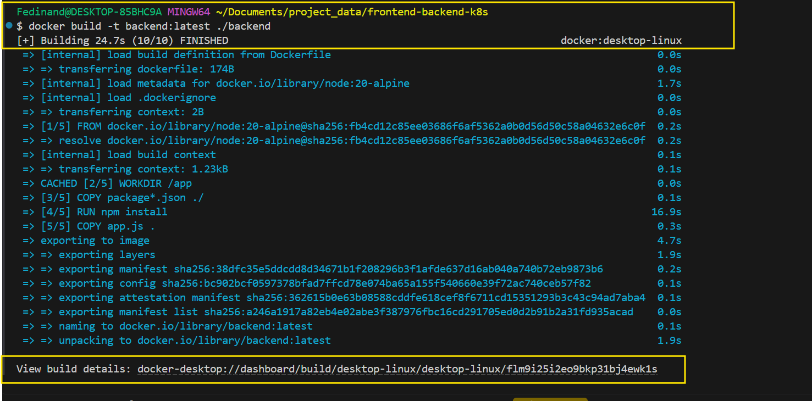

************************************************************************************

```
docker build -t frontend:latest ./frontend
```

At this point, the time I ran the first build, It started failing.
The first error was as a result of poor communication on the docker desktop, however, I have to restart the "docker-desktop"
then, It eventually started loading but failed again. 

Second troubleshooting: I have to add index.html file in the root directory of the frontend not the sub-dir of the "src"
below show all the process including the errors encountered.

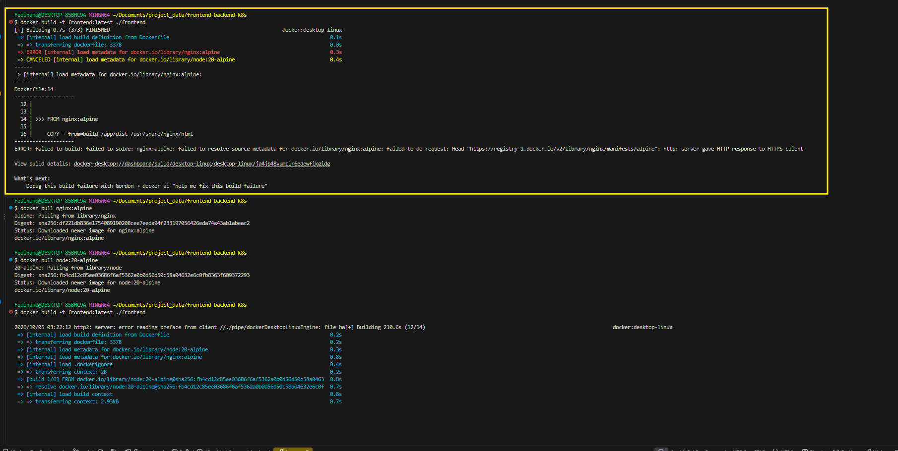

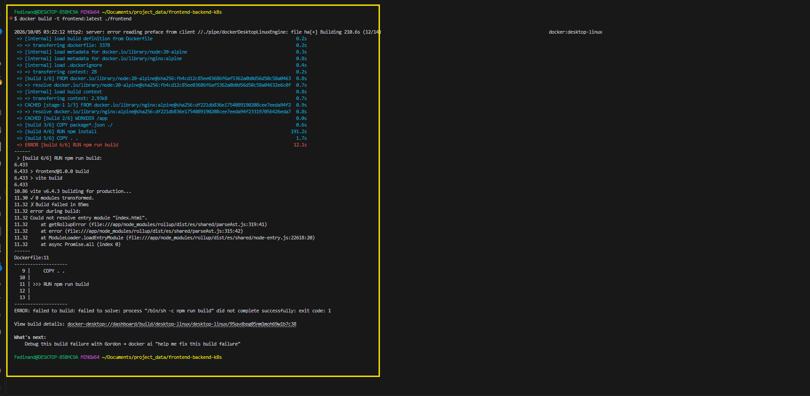

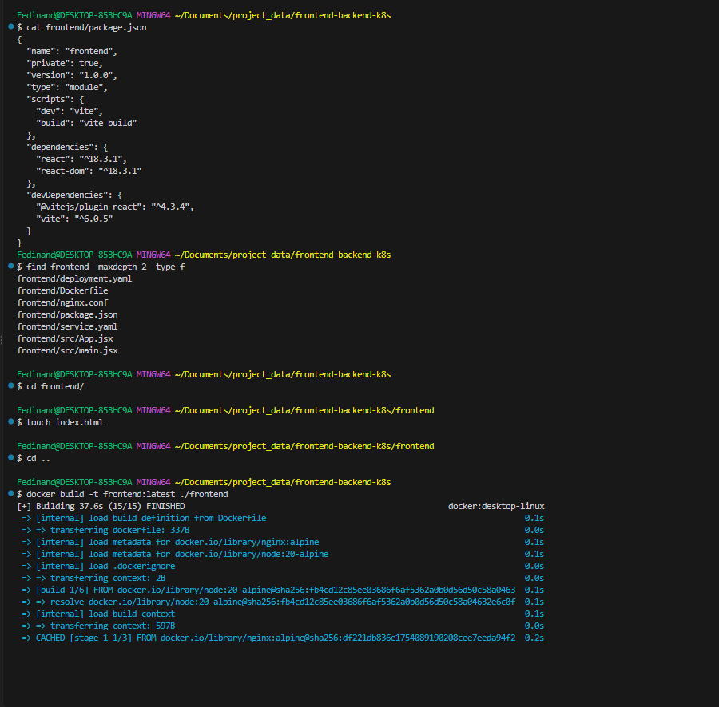

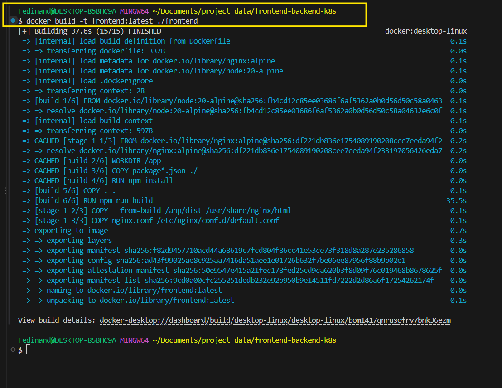

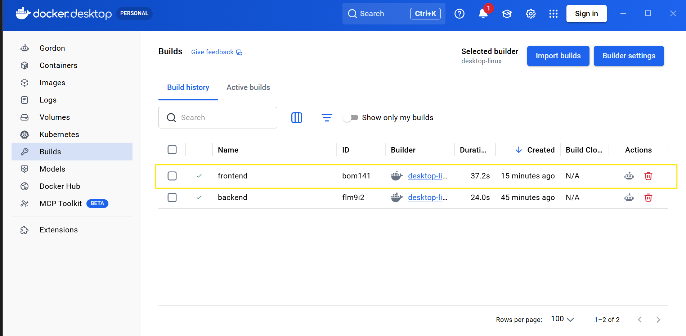


After the build I have to load the build Image into the kind cluster with the namespace called front-backend.

below are the commands to load them.

```
kind load docker-image backend:latest --name frontend-backend
kind load docker-image frontend:latest --name frontend-backend
```

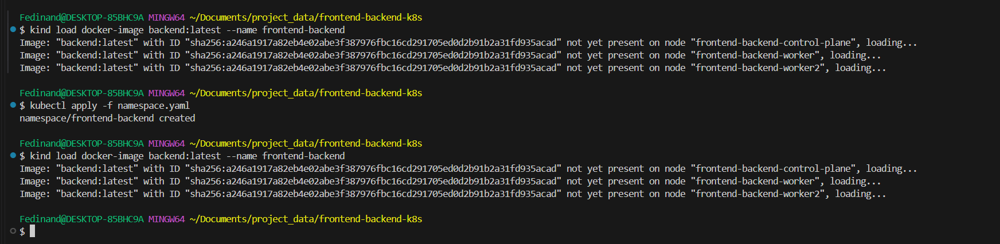

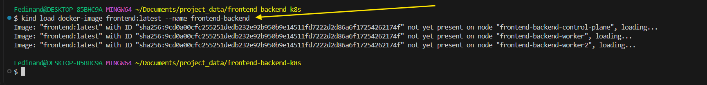

Below are the application of all the kubernetes deployment and service yaml manifest.

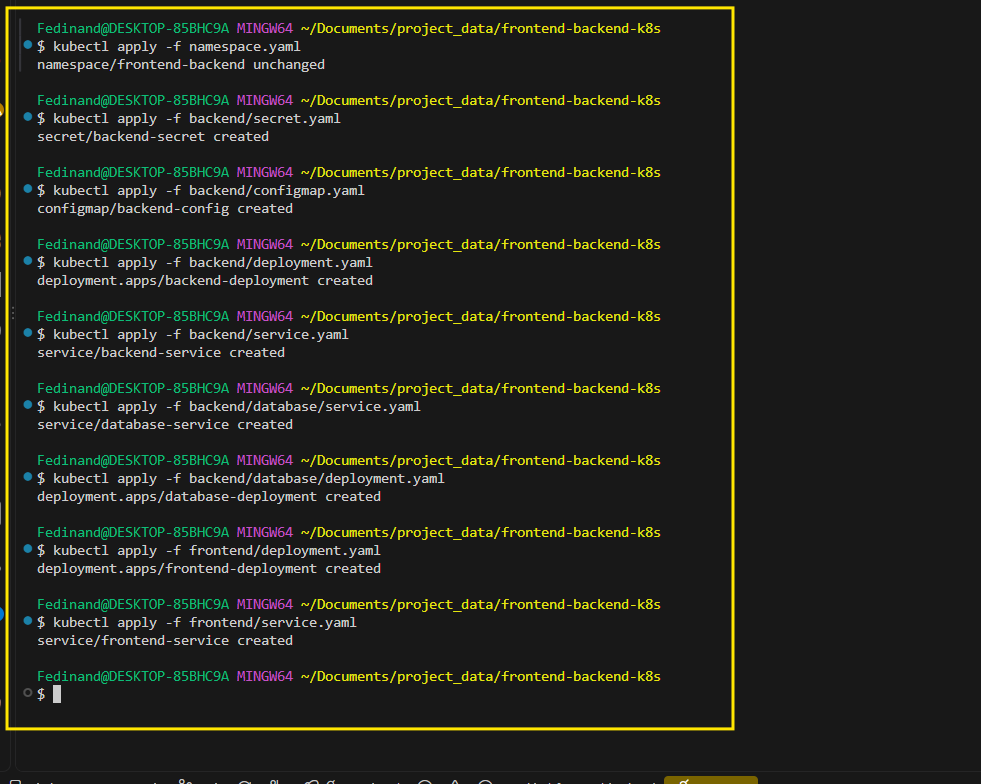


After the deployment, I used the command below to check if everything is running accordingly but unfortunately the frontend container displays error.

`kubectl get all -n frontend-backend`

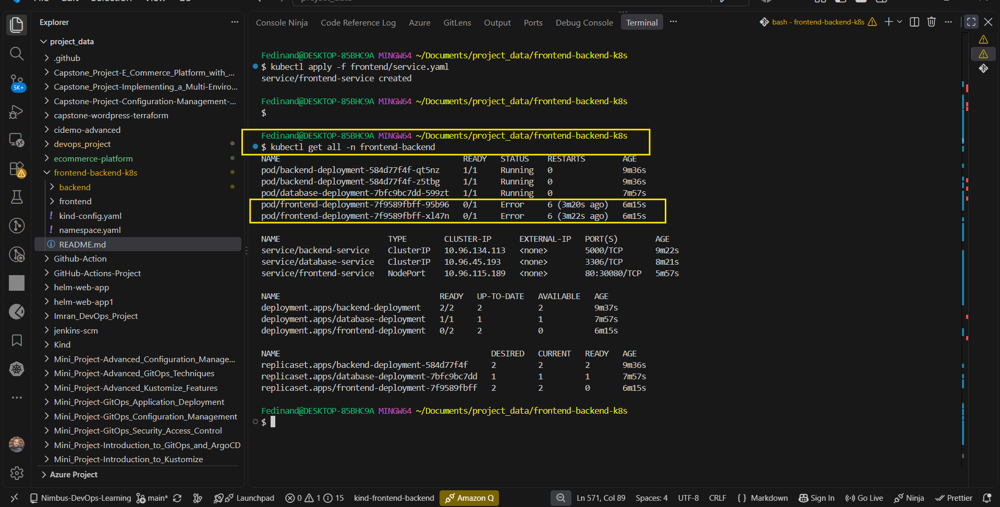


I have to check the pods error using the "log"

Below is what the error log is telling me.

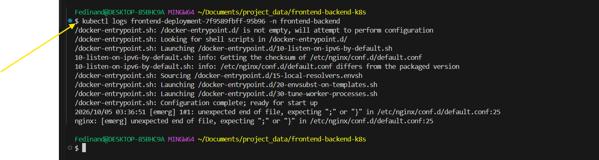

At this point the log identifies the error from the `nginx.conf` manifest in the frontend directory.

I viewed the manifest and discovered that the last line was suppose to be commented on.
After commenting on the line, I have to build it again and load in a cluster, then re-apply.

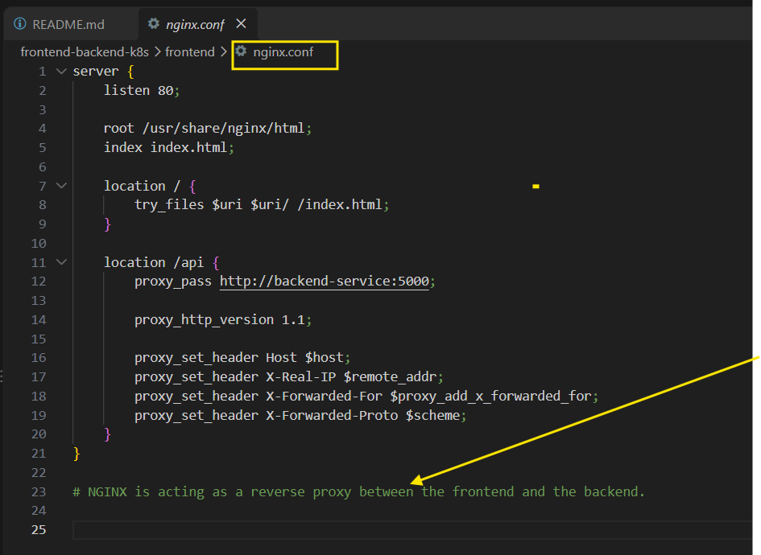

After commenting I have to re-build and re-deployed.

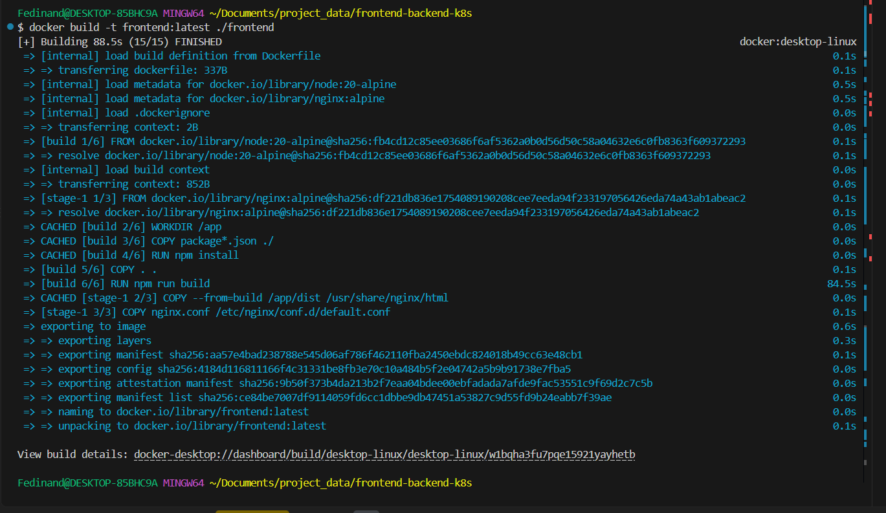


After the troubleshooting, the frontend and backend pods are running successfully.

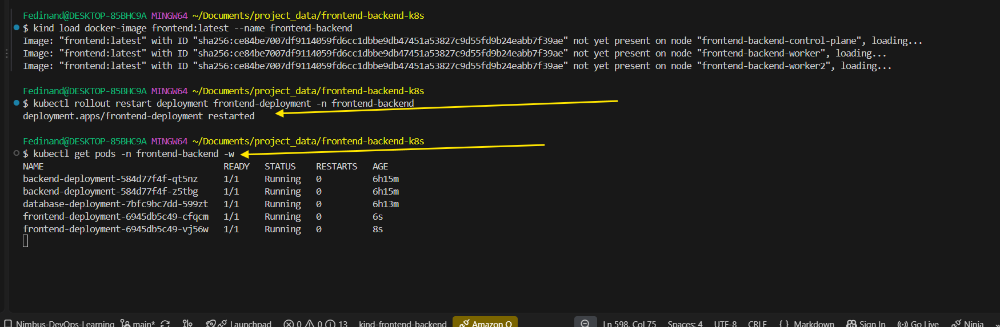


The Image shows all the resources running successfully

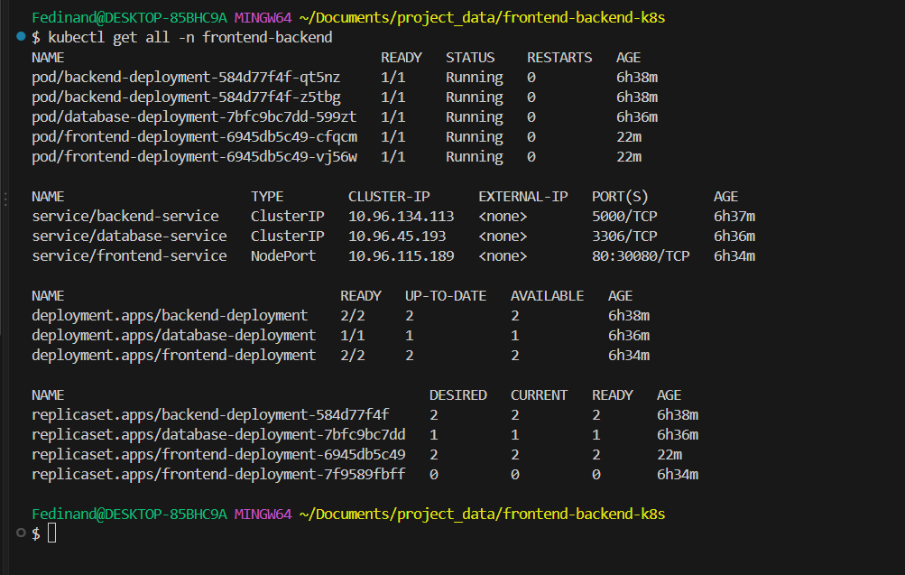
